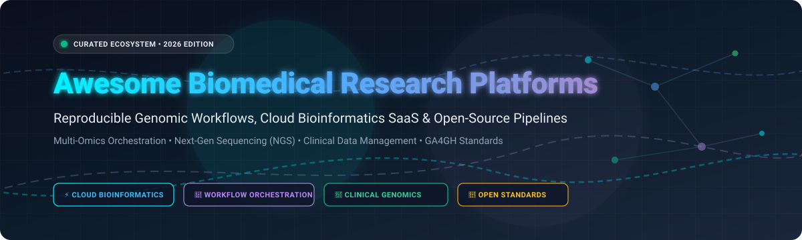

<div align="center">



# 🧬 Awesome Biomedical Research Platforms

<p align="center">
  <a href="https://github.com/ishandutta2007/Awesome-Awesome-Awesome"></a>
  <a href="https://discord.gg/jc4xtF58Ve"></a>
  <a href="https://github.com/ishandutta2007/Awesome-Awesome-Awesome"></a>
  <a href="https://en.wikipedia.org/wiki/Bioinformatics"></a>
  <a href="http://creativecommons.org/publicdomain/zero/1.0/"></a>
  <a href="https://github.com/ishandutta2007"></a>
</p>

**A community-curated collection of premier Biomedical Research Platforms, cloud bioinformatics Software-as-a-Service (SaaS) products, and production-grade open-source workflow orchestration engines.**

*Focused on reproducible genomic analysis 🧪, clinical NGS secondary analysis 🔬, workflow pipelines ⚙️, and biomedical research data management (RDM) 🗄️.*

**Last updated: October 2026** 📅

</div>

---

## 📑 Table of Contents

- [🔭 Overview](#-overview)
- [📈 Sector Overview & Market Dynamics](#-sector-overview--market-dynamics)
- [☁️ SaaS & Hosted Biomedical Platforms](#️-saas--hosted-biomedical-platforms)
- [💻 Open-Source GitHub Projects](#-open-source-github-projects)
- [🏗️ Core Architecture & Interoperability Standards](#️-core-architecture--interoperability-standards)
- [🤝 How to Contribute](#-how-to-contribute)
- [⭐ Star History](#--star-history)
- [💖 Support](#-support)
- [⚖️ Compliance & Regulatory Notice](#️-compliance--regulatory-notice)

---

## 🔭 Overview

Modern biomedical research platforms empower clinical diagnostic laboratories, biopharmaceutical enterprises, and academic bioinformatics teams to orchestrate and execute compute-intensive, fully reproducible analyses 🧬—including quality control, read alignment, variant calling, single-cell RNA sequencing (scRNA-seq), spatial transcriptomics, and ACMG clinical annotation—seamlessly across local workstations, high-performance computing (HPC) clusters, and multi-cloud environments (AWS ☁️, Azure 🌐, Google Cloud ⛅).

---

## 📈 Sector Overview & Market Dynamics

The global bioinformatics and biomedical research software market is valued at approximately **$16B to $18.5B**, growing at a compound annual growth rate (**CAGR**) of **13% to 14%** toward $35B+ driven by high-throughput next-generation sequencing (NGS), multi-omics integration, and AI-assisted clinical biomarker discovery 🚀. The market remains **moderately fragmented** at the algorithmic innovation tier—with hundreds of specialized academic point tools and diagnostic niche solutions—while exhibiting **strong consolidation** at the enterprise platform tier, where dominant sequencing and life science leaders (such as Illumina, QIAGEN, and PE-backed platform aggregators) acquire point solutions to provide unified, compliant end-to-end ecosystems 🏢.

---

## ☁️ SaaS & Hosted Biomedical Platforms

*Leading commercial, cloud-native biomedical data analysis, clinical genomics, and workflow execution platforms, ranked by corporate scale (market capitalization / valuation / annual revenue) 📊.*

| 🏷️ Platform | 🏢 Scale (Valuation / Revenue) | 💳 Pricing | 🎁 Free Tier / Trial Limits | 🔍 Key Capabilities & Highlights |
| :--- | :--- | :--- | :--- | :--- |
| **[Illumina BaseSpace](https://www.illumina.com/products/by-type/informatics-products/basespace-sequence-hub.html)** | Market Cap: **~$42B** (Rev: ~$4.5B) | Pay-as-you-go via BioInsight Credits ($1/BIC); compute ~$0.50–$3.50/hr per node; Enterprise subscriptions custom | **30-day free trial** with 1 TB cloud storage and **100–250 BioInsight Credits**; free perpetual tier limited to 1 TB with restricted app runs | Direct instrument streaming from Illumina sequencers 🧬, push-button secondary analysis (DRAGEN pipelines), and secure FASTQ sharing. |
| **[QIAGEN Digital Insights](https://digitalinsights.qiagen.com/)** | Market Cap: **~$9.4B** (Rev: ~$2.1B) | Desktop/Named User licenses starting at **~$4,500–$6,500/yr** (CLC Genomics Workbench); Server and IPA custom-quoted | **14-day fully functional evaluation license** (renewable upon request); 90-day trial for qualifying NGS benchtop sequencer owners | Comprehensive desktop-to-server NGS suite (CLC Genomics Workbench, Ingenuity Pathway Analysis / IPA), biomedical ontologies, and clinical variant classification 🔬. |
| **[SOPHiA GENETICS](https://www.sophiagenetics.com/)** | Market Cap: **~$620M** (Rev: ~$86M) | Clinical per-analysis pricing starting at **~$50–$250/sample** depending on panel/exome scope; enterprise SaaS commitments | **30-day pilot proof-of-concept** with up to 10 sample analyses included upon institutional clinical evaluation agreement | Cloud-native SOPHiA DDM platform featuring multimodal AI/ML analytics 🤖, predictive oncology profiling, and automated ACMG/AMP variant interpretation. |
| **[DNAnexus](https://www.dnanexus.com/)** | Valuation: **~$600M** (Rev: ~$84M) | Base subscription tiers starting at **~$10,000/yr** plus compute pass-through; AWS Marketplace contracts starting at **~$5,000** | **£40 / $50 startup credit grant** on research instances (e.g., UK Biobank RAP); 30-day pilot PoC for enterprise evaluations | Enterprise biomedical informatics platform with governed project boundaries 🛡️, UK Biobank RAP engine, CWL/WDL/Nextflow orchestration, and OCI/AWS multi-cloud GPUs. |
| **[Seven Bridges (Velsera)](https://www.sevenbridges.com/)** | Valuation: **~$400M** (Velsera PE est.) | Direct pass-through cloud compute (AWS/GCP) + enterprise platform fee; starting custom pilot tiers from **~$10,000** | **$300 cloud credit grant** upon registration on Cancer Genomics Cloud (CGC) pilot (covers ~40 exomes or ~20 RNA-seq runs) | CWL-native workflow platform 🌐, host of NCI Cancer Genomics Cloud (850+ curated workflows), multi-cloud execution (AWS, GCP), and enterprise ARIA harmonization. |
| **[Fabric Genomics](https://www.fabricgenomics.com/)** | Valuation: **~$85M** (Private, $50M raised) | Sample-to-report clinical sequencing from **~$1,000/sample** (WGS); software-only interpretation licenses starting at **~$12,000/yr** | **14-day institutional pilot evaluation** limited to 5 test sample VCF/BAM uploads for validation benchmarking | AI-driven clinical interpretation platform (Fabric Enterprise & GEM algorithm) featuring automated ACMG scoring for rare disease diagnosis and somatic oncology 🩺. |
| **[BC Platforms](https://www.bcplatforms.com/)** | Valuation: **~$60M** (Rev: ~$20M) | Annual institutional platform licenses starting at **~$25,000/yr**; GeneVision modular tiers quote-based | **30-day structured sandbox trial** with simulated cohort datasets upon verified institutional/pharma request | High-scale biobank data management 🏥, automated GWAS workflows, federated clinical cohort discovery, and genomic data governance across healthcare networks. |
| **[LifeOmic](https://lifeomic.com/)** | Valuation: **~$45M** (Acquired, ARR ~$3.5M) | Historical baseline starting at **$5.00/user/month** for wellness suites; enterprise Precision Health Platform quotes from **~$15,000/yr** | **14-day free trial** of Precision Health dashboard with 5 patient/subject record slots and 5 GB storage limit | Secure precision health platform integrating patient EHR data, mobile health metrics 📱, and clinical sequencing pipelines in a HIPAA-compliant cloud vault. |
| **[Genialis](https://www.genialis.com/)** | Valuation: **~$25M** (Private, $23.5M raised) | Enterprise biopharma subscription contracts starting at **~$30,000/yr** (Genialis ResponderID / Expressions) | **30-day private pilot program** for oncology biomarker validation on up to 2 user-supplied RNA-seq cohorts | RNA-centric computational biology and patient stratification platform for predictive biomarker discovery 🎯, drug mechanism validation, and clinical trial enrichment. |
| **[Partek Flow](https://www.partek.com/partek-flow/)** | Valuation: **~$20M** (Rev: ~$5M) | Academic lab group licenses starting at **$3,080/yr**; enterprise commercial server licenses starting at **~$8,500/yr** | **14-day full-feature trial license** (includes desktop/server seat with access to demo data, RNA-seq, and single-cell tools) | Visual, point-and-click NGS analytics software for bioinformaticians and bench biologists; specialized in scRNA-seq, bulk RNA-seq, ATAC-seq, and spatial transcriptomics 🧪. |

---

## 💻 Open-Source GitHub Projects

*Production-ready, vendor-independent open-source platforms and tool suites for self-hosted biomedical research, ranked by GitHub stargazer popularity ⭐.*

| 📦 Project | ⭐ GitHub_Stars | 🎯 Primary Purpose | 🛠️ Tech Stack / License |
| :--- | :--- | :--- | :--- |
| **[Pachyderm](https://github.com/pachyderm/pachyderm)** | [](https://github.com/pachyderm/pachyderm/stargazers) | Data versioning, git-like data lineage, and containerized workflow orchestration for data-driven pipelines 📦. | Go / Apache-2.0 |
| **[Nextflow](https://github.com/nextflow-io/nextflow)** | [](https://github.com/nextflow-io/nextflow/stargazers) | Scalable, portable dataflow programming framework for reproducible bioinformatics pipelines across Slurm, AWS Batch, and k8s 🚀. | Groovy, Java / Apache-2.0 |
| **[Snakemake](https://github.com/snakemake/snakemake)** | [](https://github.com/snakemake/snakemake/stargazers) | Pythonic rule-based workflow engine with declarative dependency resolution and seamless multi-cloud / HPC execution 🐍. | Python / MIT |
| **[STAR](https://github.com/alexdobin/STAR)** | [](https://github.com/alexdobin/STAR/stargazers) | Ultrafast universal RNA-seq aligner capable of discovering non-canonical splices, chimeric transcripts, and circular RNAs ⚡. | C++ / MIT |
| **[GATK](https://github.com/broadinstitute/gatk)** | [](https://github.com/broadinstitute/gatk/stargazers) | Broad Institute's industry-standard Genome Analysis Toolkit for variant discovery and germline/somatic genotyping 🔬. | Java / BSD-3-Clause |
| **[Samtools](https://github.com/samtools/samtools)** | [](https://github.com/samtools/samtools/stargazers) | Foundational utilities for manipulating, indexing, and viewing high-throughput sequencing data in SAM, BAM, and CRAM formats 🛠️. | C / MIT, BSD |
| **[Galaxy](https://github.com/galaxyproject/galaxy)** | [](https://github.com/galaxyproject/galaxy/stargazers) | Open-source web-based biomedical analysis platform with graphical workflow builder, 175+ single-cell tools, and community ToolShed 🌌. | Python, JavaScript / AFL-3.0 |
| **[Common Workflow Language (CWL)](https://github.com/common-workflow-language/common-workflow-language)** | [](https://github.com/common-workflow-language/common-workflow-language/stargazers) | Open specification and reference standards for hardware-agnostic, portable descriptions of multi-step genomic pipelines 📜. | YAML, JSON / Apache-2.0 |
| **[Cromwell](https://github.com/broadinstitute/cromwell)** | [](https://github.com/broadinstitute/cromwell/stargazers) | Enterprise execution engine for WDL and CWL workflows optimized for GATK pipelines across local, Google Cloud, and AWS ⚙️. | Scala / BSD-3-Clause |
| **[cBioPortal](https://github.com/cBioPortal/cbioportal)** | [](https://github.com/cBioPortal/cbioportal/stargazers) | Open-source cancer genomics data visualization and exploration platform used by MSKCC, Dana-Farber, and research consortia worldwide 📊. | Java, TypeScript / AGPL-3.0 |
| **[bcbio-nextgen](https://github.com/bcbio/bcbio-nextgen)** | [](https://github.com/bcbio/bcbio-nextgen/stargazers) | Validated, community-developed pipeline framework for automated, scalable variant calling, RNA-seq, and structural variant analysis 🧪. | Python / MIT |
| **[Toil](https://github.com/DataBiosphere/toil)** | [](https://github.com/DataBiosphere/toil/stargazers) | UCSC scalable workflow management engine with comprehensive CWL/WDL execution support across AWS, GCP, Azure, and HPC 🌐. | Python / Apache-2.0 |
| **[iRODS](https://github.com/irods/irods)** | [](https://github.com/irods/irods/stargazers) | Integrated Rule-Oriented Data System providing policy-based research data management, multi-tier storage, and metadata virtualization 🗃️. | C++ / BSD-3-Clause |
| **[Arvados](https://github.com/arvados/arvados)** | [](https://github.com/arvados/arvados/stargazers) | Open-source platform for biomedical big data management, CWL pipeline orchestration, and secure cloud storage (Keep) 🔒. | Go, Python, Ruby / AGPL-3.0 |
| **[SENAITE LIMS](https://github.com/senaite/senaite.core)** | [](https://github.com/senaite/senaite.core/stargazers) | Enterprise-grade Laboratory Information Management System (LIMS) for biobanks, clinical diagnostic labs, and research facilities 🏥. | Python / GPL-2.0 |
| **[nf-core tools](https://github.com/nf-core/tools)** | [](https://github.com/nf-core/tools/stargazers) | CLI suite for scaffolding, testing, linting, and maintaining peer-reviewed Nextflow pipelines adhering to strict community standards 🧰. | Python / MIT |
| **[GRIDSS](https://github.com/PapenfussLab/gridss)** | [](https://github.com/PapenfussLab/gridss/stargazers) | Ultra-sensitive genomic rearrangement and structural variation (SV) detection suite combining split-read and read-pair analysis 🧬. | Java, R / GPL-3.0 |
| **[OpenELIS Global](https://github.com/DIGI-UW/OpenELIS-Global-2)** | [](https://github.com/DIGI-UW/OpenELIS-Global-2/stargazers) | Open enterprise laboratory information system designed for public health diagnostic networks and hospital labs worldwide 🌍. | Java / GPL-3.0 |
| **[Dockstore](https://github.com/dockstore/dockstore)** | [](https://github.com/dockstore/dockstore/stargazers) | GA4GH-compliant registry platform for sharing containerized scientific workflows in CWL, WDL, Nextflow, and Galaxy formats 🐳. | Java, TypeScript / Apache-2.0 |
| **[Seqera Wave](https://github.com/seqeralabs/wave)** | [](https://github.com/seqeralabs/wave/stargazers) | Cloud-native container provisioning service providing on-demand Singularity/Docker image assembly for pipeline tasks 🌊. | Go / Apache-2.0 |
| **[KBase Narrative](https://github.com/kbase/narrative)** | [](https://github.com/kbase/narrative/stargazers) | Department of Energy Systems Biology Knowledgebase collaborative notebook interface for systems biology and multi-omics analysis 📓. | Python, TypeScript / MIT |
| **[LabKey Server](https://github.com/LabKey/server)** | [](https://github.com/LabKey/server/stargazers) | Extensible data integration platform for translational biomedical research, assay tracking, and longitudinal study management 🧪. | Java / Apache-2.0 |

---

## 🏗️ Core Architecture & Interoperability Standards

```
  +-----------------------------------------------------------------------------+
  |                        High-Level Interfaces & Portals                      |
  |             Galaxy Project  |  cBioPortal  |  KBase Narrative               |
  +-------------------------------------+---------------------------------------+
                                        |
  +-------------------------------------v---------------------------------------+
  |                      Workflow Orchestration & Engines                       |
  |       Nextflow (nf-core)  |  Snakemake  |  Cromwell (WDL)  |  Toil (CWL)     |
  +-------------------------------------+---------------------------------------+
                                        |
  +-------------------------------------v---------------------------------------+
  |                 Underlying Algorithms & Processing Core                     |
  |         Samtools / HTSlib  |  BWA / STAR  |  GATK4  |  GRIDSS               |
  +-------------------------------------+---------------------------------------+
                                        |
  +-------------------------------------v---------------------------------------+
  |                   Data Governance, RDM & Lab Management                     |
  |             Pachyderm  |  iRODS  |  SENAITE LIMS  |  OpenELIS               |
  +-----------------------------------------------------------------------------+
```

### 📚 Complementary Ecosystem Standards
- **[Bioconductor](https://bioconductor.org/)**: The premier R-based computational biology ecosystem containing 2,000+ packages (`GenomicRanges`, `DESeq2`, `SingleCellExperiment`) for statistical analysis of high-throughput genomic data 📈.
- **[openBIS](https://openbis.ch/)**: An open-source research data management and electronic laboratory notebook (ELN-LIMS) platform developed by ETH Zurich for tracking samples, protocols, and multi-omics datasets 🔬.
- **[GA4GH (Global Alliance for Genomics and Health)](https://www.ga4gh.org/)**: Standards organization establishing interoperability APIs including **WES** (Workflow Execution Service), **TES** (Task Execution Service), and **DRS** (Data Repository Service) 🌐.

---

## 🤝 How to Contribute

We welcome community contributions, tool updates, and platform additions! 🎉

1. Fork this repository 🍴.
2. Add your tool to the appropriate section (`SaaS & Hosted Biomedical Platforms` or `Open-Source GitHub Projects`) ✍️.
3. Maintain alphabetical or star-sorted order and ensure all links, pricing details, and free-tier boundaries are verified ✅.
4. Submit a Pull Request with a concise summary of the platform's focus 🚀.

---

##  Star History
[](https://star-history.dera.page/#ishandutta2007/Awesome-Biomedical-Research-Platforms&type=date&legend=top-left)

---

## 💖 Support

Thank you for exploring and utilizing **Awesome Biomedical Research Platforms**! 🙏

If you find this curated collection helpful for your research, lab pipelines, or infrastructure engineering, please consider showing your support:
- ⭐ **Star this repository** to help others discover it across the bioinformatics community.
- 🍴 **Fork and contribute** by adding new tools, clinical pipelines, or benchmark insights.
- 📢 **Share with colleagues**, research networks, and computational biology teams.
- ☕ **Sponsor & Buy a Coffee**: If you'd like to support ongoing curation and open-source maintenance, consider sponsoring via the [GitHub Sponsors Dashboard](https://github.com/sponsors/ishandutta2007).

---

## ⚖️ Compliance & Regulatory Notice

Platforms processing human genomic and clinical phenotypic information must comply with stringent international regulatory frameworks:
- **HIPAA & HITECH** (United States) 🇺🇸: Rigorous safeguards for Protected Health Information (PHI) and Business Associate Agreements (BAAs).
- **GDPR** (European Union) 🇪🇺: Strict genetic data privacy rights, cross-border data transfer controls, and explicit subject consent protocols.
- **CLIA / CAP Accreditation** 🏥: High-complexity clinical laboratory standards governing NGS analytical validation, variant calling calibration, and diagnostic reporting.
- **IRB & Data Residency** 🌐: Ensure cloud execution regions (AWS, Azure, GCP) honor institutional data sovereignty requirements before deploying pipelines.

---

<div align="center">

**Curated with precision for bioinformaticians, computational biologists, and biomedical systems engineers.** 🧬💻🚀

</div>
